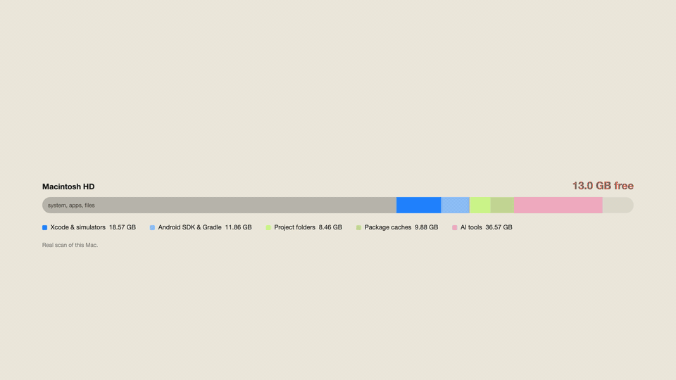
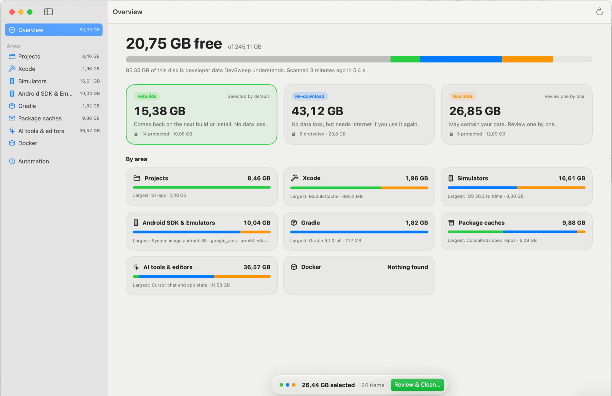
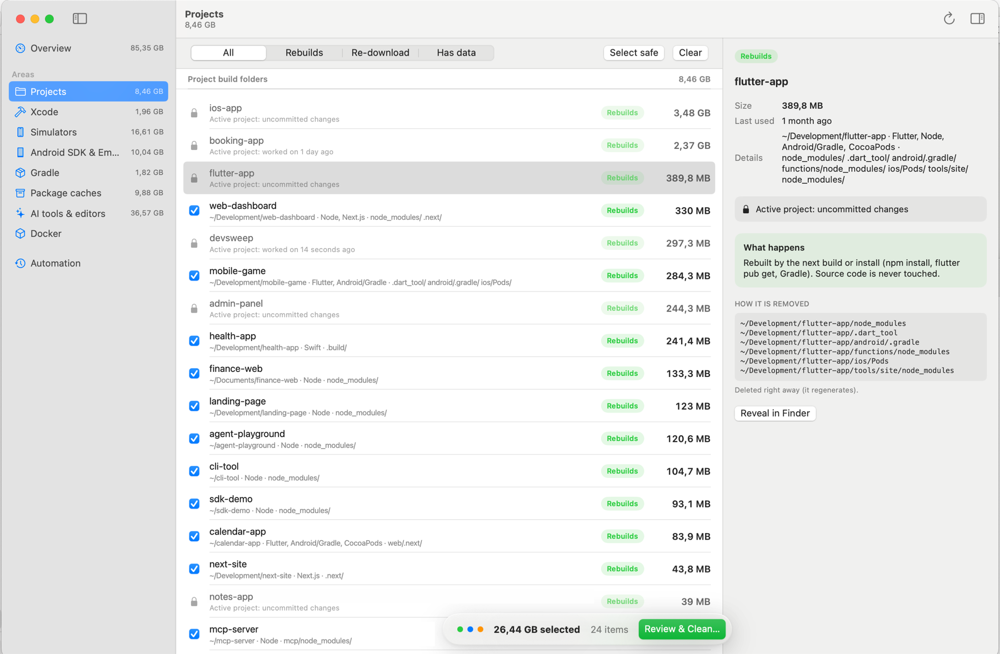
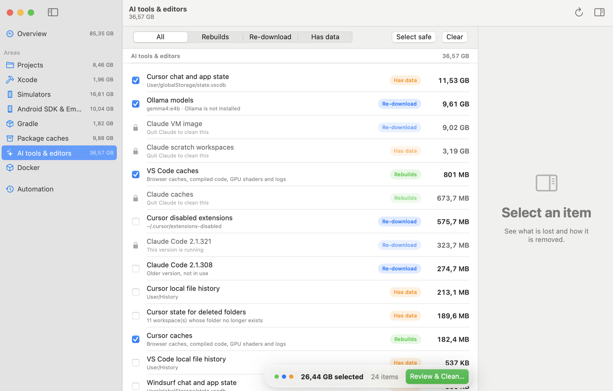
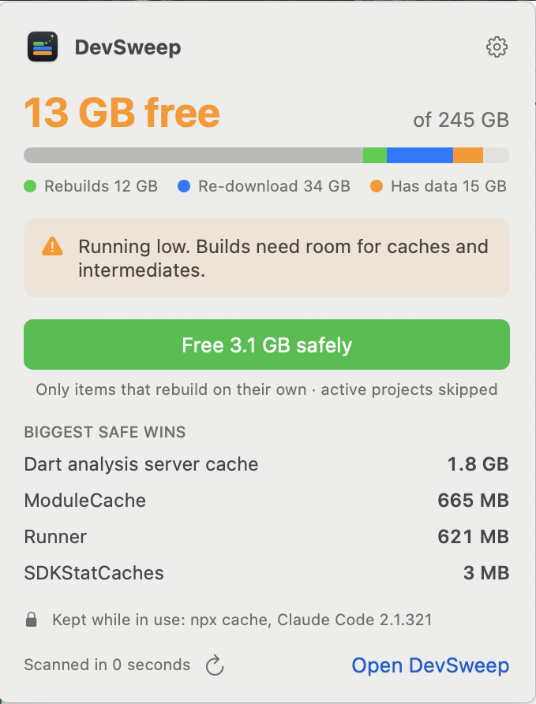
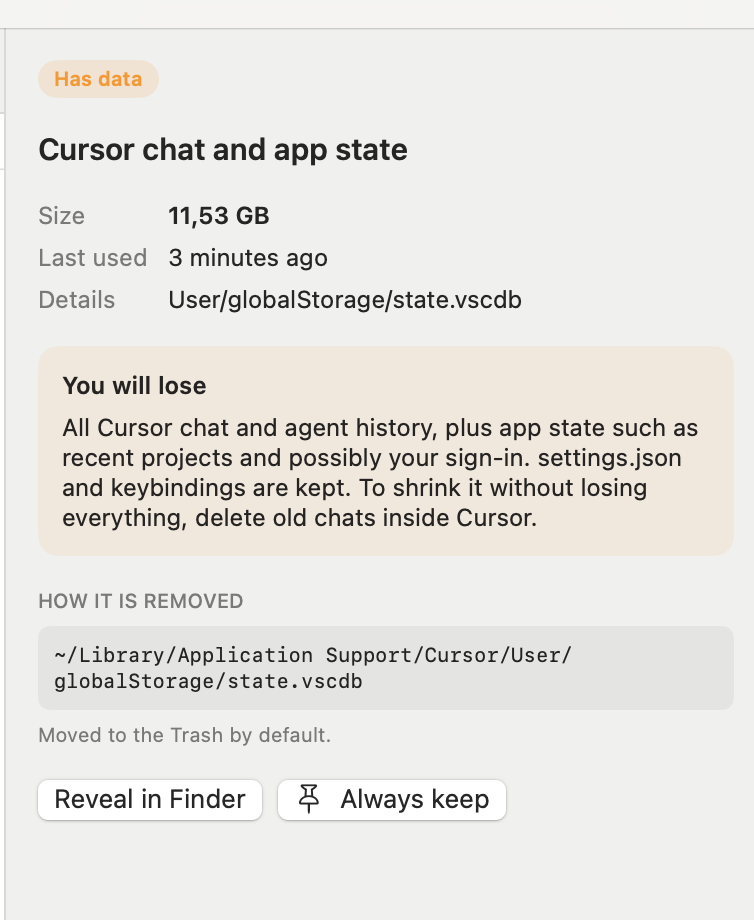

# DevSweep

Safe disk cleanup for developers on macOS. DevSweep knows Xcode, iOS simulators, the Android SDK and emulators,
Gradle, project build folders and package-manager caches, and tells you **what is safe to remove before you remove it**.



> **Heads-up:** DevSweep deletes files. It is built to be careful (see the safety model below), but it comes
> with no warranty. Try `devsweep clean --dry-run` first and keep a backup (Time Machine) of anything you care about.

> **Project status:** a personal tool I built for my own Mac and share in case it helps others. I maintain it
> as time allows, with no support or response-time guarantee. Issues and pull requests are welcome, but may
> go unanswered for a while.

## Screenshots







<p align="center">
  
  &nbsp;
  
</p>

## Safety model

Every item gets one of three tiers:

| Tier | Meaning | Default |
|---|---|---|
| **Rebuilds** | Regenerated by the next build or install (DerivedData, `~/.gradle/caches`, `node_modules`, `build/`) | Selected, deleted outright |
| **Re-download** | No data loss, but needs internet again (simulator runtimes, system images, NDKs, Gradle dists) | Not selected, moved to Trash |
| **Has data** | May hold your own state (simulators, emulators, Xcode archives with dSYMs, Maven local installs) | Never auto-selected, needs explicit confirmation |

Protected automatically: running simulators and emulators, open Xcode's recent DerivedData, Gradle while a daemon
or Android Studio runs, projects with uncommitted changes or commits in the last 7 days, Gradle versions and system
images still in use, the newest build-tools, archives newer than 90 days, npx tools that are running.

Before anything is removed, `PathSafety` checks every path again: it must be inside your home folder (or the Android
SDK), at least two levels deep, not a critical folder, not inside `.git`, and not reached through a symlink.
Simulators and runtimes are removed with `xcrun simctl`, never with `rm`.

## Build

```bash
scripts/bundle.sh          # dist/DevSweep.app and dist/devsweep
swift test
```

Runs on macOS 14+. Building needs Xcode 26+ (for the Liquid Glass APIs).

The bundled app is ad-hoc signed, not notarized, so Gatekeeper blocks the first launch. Right-click
`DevSweep.app` and choose **Open**, or clear the quarantine flag once:

```bash
xattr -dr com.apple.quarantine dist/DevSweep.app
```

## CLI

```bash
devsweep status                              # free space and totals per tier
devsweep scan [--json]                       # everything found, grouped by area
devsweep clean --tier rebuilds --dry-run     # what would be removed
devsweep clean --tier rebuilds --yes         # remove all unprotected Rebuilds items
```

Has-data items can only be removed from the app, one by one.

## Large files

A separate **Large files** section lists your own files over 100 MB (installers, archives, videos, documents)
so you can find what fills the disk beyond developer data. It is deliberately apart from the safe cleans:
nothing is selected for you, files always go to the Trash first, and they are never touched by the menu bar
button, rules, the CLI or AI agents. Git repositories, sync folders, ~/Library and app packages are not searched.

## AI agents (MCP)

`devsweep mcp` is a Model Context Protocol server over stdio. Add it to Claude Code:

```bash
claude mcp add devsweep -- /Applications/DevSweep.app/Contents/Resources/devsweep mcp
```

| Tool | What it does |
|---|---|
| `disk_status` | Free space and, from the cached last scan, how much is safe to free. Instant. |
| `plan_cleanup` | Read-only list of what a tier would remove and what stays protected and why. |
| `clean_safe` | Scans, then removes unprotected **Rebuilds** items only. Off when "Allow AI agents to clean" is off. |

### Agent skill

[`skills/devsweep/SKILL.md`](skills/devsweep/SKILL.md) tells the agent when to reach for these tools
(disk full, `No space left on device`, "what is using my disk") and how: check, plan, ask, then clean.
Install it for Claude Code:

```bash
mkdir -p ~/.claude/skills && cp -R skills/devsweep ~/.claude/skills/
```

Every clean (app, menu bar, notification, CLI, MCP, rules) is logged in
`~/Library/Application Support/DevSweep/history.jsonl` and shown under Automation > History
(`devsweep history` in the terminal).

## Status

v0.7: Large files section for your own big files outside developer folders.

v0.6: agent worktrees. Finds git worktrees left behind by Cursor, Claude Code and Codex (and any other
worktree of your repositories) and removes them with `git worktree remove`, never `--force`. Worktrees
with uncommitted or untracked files, commits on no branch, a lock, or use in the last 7 days are kept;
the branch always stays. Fixed: the safe clean always reported one failure (Dart analysis cache);
history now keeps the reason for every skipped item.

v0.5: rescans in about a second (unchanged folders reuse their size for up to a day; Rescan Fully
with ⇧⌘R or `--full`), Docker (build cache, unused images, stopped containers, anonymous volumes via
`docker ... prune`), Cursor's chat database shows how little compacting would free, closer glass look on
macOS 14 and 15.

v0.4: MCP server, automation rules (weekly stale-project sweep, auto-clean when almost full,
remove unavailable simulators; all off by default), "Always keep" list shared by every entry point,
clean history, instant launch from the cached last scan, option to start in the menu bar only.

v0.3: AI tools & editors area, live scan progress, Liquid Glass controls, app icon.

v0.2: menu bar popover with live free space and one-click safe clean, low-disk notifications
(one per step down, re-armed after recovery, with a "Free X safely" action), settings (threshold,
notifications, menu bar text, Dock icon, open at login).

v0.1: scanner, 11 recipes, app (overview, area detail with inspector, review sheet), CLI.

Next: see `ROADMAP.md`.

Notifications and open-at-login only work from the bundled app (`scripts/bundle.sh`), not from `swift run`.

## License

MIT, see [LICENSE](LICENSE). Security issues: see [SECURITY.md](SECURITY.md).
